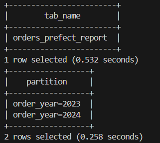
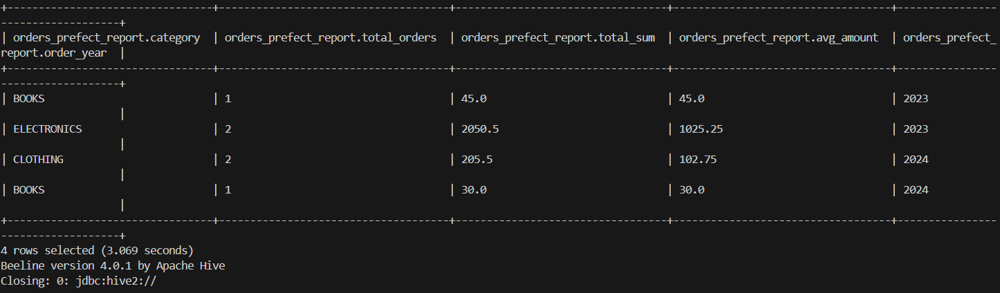
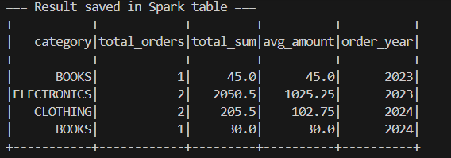
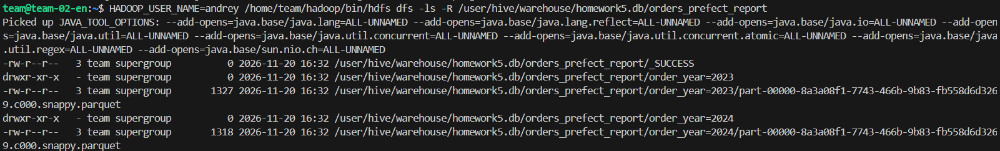
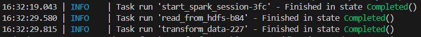
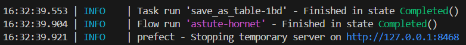
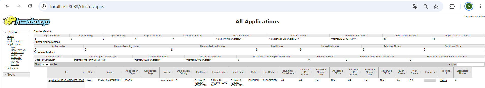

## Автоматизированное развертывание Prefect
Репозиторий содержит скрипты для автоматизированного развертывания Prefect и PySpark поверх существующего кластера Hadoop HDFS, YARN, HIVE и SPARK, а также автоматизации ETL-процесса в рамках потока Prefect: запуска сессии Spark под управлением YARN, чтения данных из HDFS, преобразования типов, фильтрации, агрегации, динамического партиционирования и сохранения данных в формате Parquet в виде таблицы с последующей валидацией через клиент Hive.

## Архитектура кластера

Развертывание производится на следующих виртуальных машинах (ОС Ubuntu):
* team-02-en - Prefect

## Структура репозитория
```
├── deploy-prefect.sh     # bash-скрипт автоматизированного развертывания виртуального окружения Prefect и PySpark
├── run-prefect-job.sh    # bash-скрипт загрузки данных на HDFS, запуска Prefect-потока и проверки через Beeline
├── scripts/              # скрипты обработки данных
│   └── etl_flow.py
└── evidences/            # скриншоты Web-интерфейса YARN, логов запуска Prefect, HDFS и Beeline
```

## Инструкция по запуску
С локальной машины отправить скрипты на edge-ноду:
```
scp -i ~/.ssh/<SSH_KEY> -r deploy-prefect.sh run-prefect-job.sh scripts team@<IP_EDGE_NODE>:~
ssh -i ~/.ssh/<SSH_KEY> team@111.88.128.191
```
Затем выполнить:
```
chmod +x deploy-prefect.sh run-prefect-job.sh
./deploy-prefect.sh
./run-prefect-job.sh
```

## Логи запуска и веб интерфейс:









## Инструкция по остановке
Остановка HIVE: pkill -f RunJar

Остановка HistoryServer: ssh -i ~/.ssh/team_internal team@team-02-nn "sudo -u andrey /home/andrey/hadoop/bin/mapred --daemon stop historyserver"

Остановка YARN: ssh -i ~/.ssh/team_internal team@team-02-nn "sudo -u andrey /home/andrey/hadoop/sbin/stop-yarn.sh"

Остановка HDFS: ssh -i ~/.ssh/team_internal team@team-02-nn "sudo -u andrey /home/andrey/hadoop/sbin/stop-dfs.sh"

Остановка PostgreSQL: ssh -i ~/.ssh/team_internal team@team-02-01 "sudo systemctl stop postgresql"