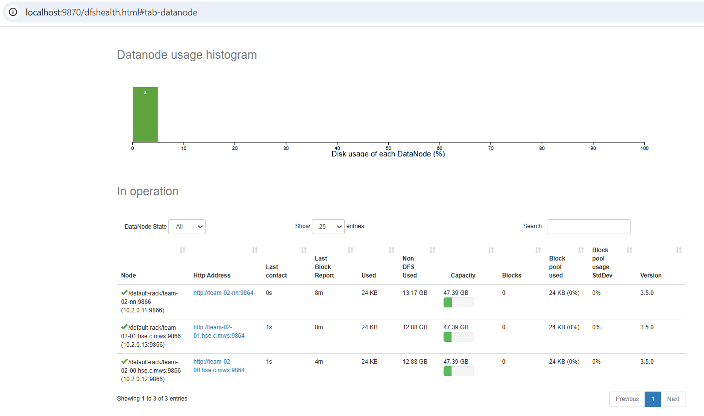
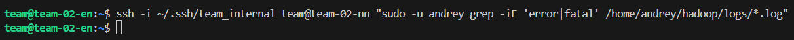

## Автоматизированное развертывание кластера Hadoop HDFS
Репозиторий содержит скрипты и конфигурационные файлы для автоматизированного развертывания кластера Hadoop HDFS (версия 3.5.0) на 3 узлах. 

## Архитектура кластера

Развертывание производится на следующих виртуальных машинах (ОС Ubuntu):
* team-02-nn (10.2.0.11) - NameNode, SecondaryNameNode, DataNode.
* team-02-00 - DataNode.
* team-02-01 - DataNode.
* team-02-en - Edge-node.

## Структура репозитория

```
.
├── deploy.sh      # bash-скрипт автоматизированного развертывания
├── configs/       # конфигурационные файлы Hadoop
│   ├── core-site.xml
│   ├── hdfs-site.xml
│   ├── hadoop-env.sh
│   └── workers
└── evidences/     # скриншоты Web-интерфейса и логи запуска
```
## Инструкция по запуску
С локальной машины отправить скрипт и конфигурации на edge-ноду:
```
scp -i ~/.ssh/<SHH> -r deploy.sh configs team@<IP_EDGE_NODE>:~
ssh -i ~/.ssh/<SHH> team@111.88.128.191 
```
Затем выполнить:
```
chmod +x deploy.sh
./deploy.sh
```

## Логи запуска и веб интерфейс:

