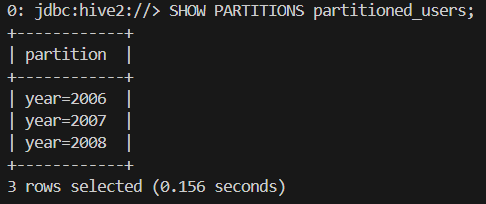
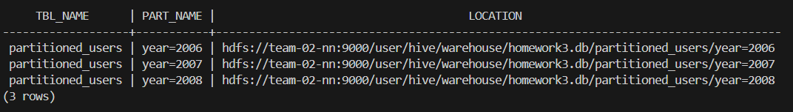
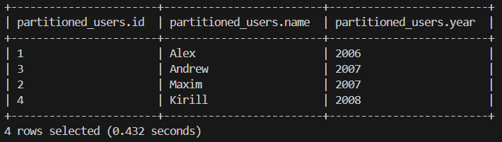
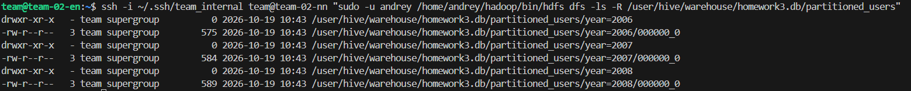
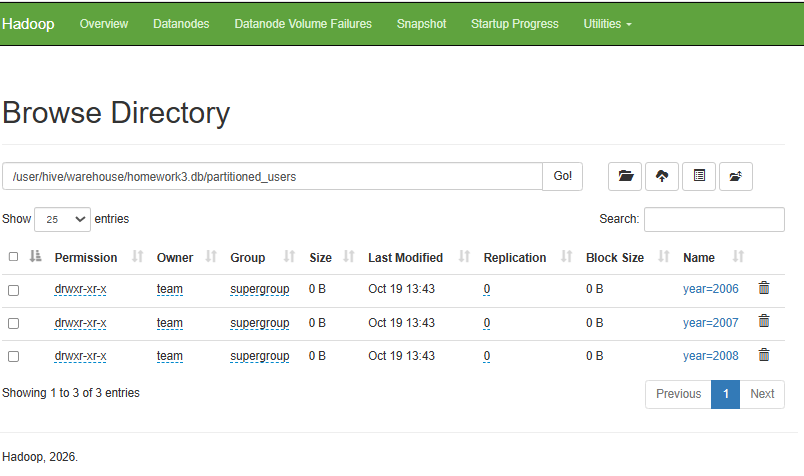

## Автоматизированное развертывание HIVE
Репозиторий содержит скрипты и конфигурационные файлы для автоматизированного развертывания HIVE поверх существующего кластера Hadoop HDFS и YARN, а также автоматизации загрузки данных в партиционированную таблицу в формате Parquet. 

## Архитектура кластера

Развертывание производится на следующих виртуальных машинах (ОС Ubuntu):
* team-02-en - Hive Client, Hive Metastore.
* team-02-01 - PostgreSQL 16

## Структура репозитория

```
.
├── deploy-hive.sh       # bash-скрипт автоматизированного развертывания
├── run-hive-job.sh      # bash-скрипт подготовки данных, загрузки в HDFS и HQL-партиционирования
├── configs/             # конфигурационные файлы
│   ├── hive-site.xml
└── evidences/           # скриншоты Web-интерфейса
```
## Инструкция по запуску
С локальной машины отправить скрипт и конфигурации на edge-ноду:
```
scp -i ~/.ssh/<SHH> -r deploy-hive.sh run-hive-job.sh configs team@<IP_EDGE_NODE>:~
ssh -i ~/.ssh/<SHH> team@111.88.128.191 
```
Затем выполнить:
```
chmod +x deploy-hive.sh run-hive-job.sh
./deploy-hive.sh
./run-hive-job.sh
```

## Веб интерфейс:






## Инструкция по остановке
Остановка HIVE: pkill -f RunJar

Остановка HistoryServer: ssh -i ~/.ssh/team_internal team@team-02-nn "sudo -u andrey /home/andrey/hadoop/bin/mapred --daemon stop historyserver"

Остановка YARN: ssh -i ~/.ssh/team_internal team@team-02-nn "sudo -u andrey /home/andrey/hadoop/sbin/stop-yarn.sh"

Остановка HDFS: ssh -i ~/.ssh/team_internal team@team-02-nn "sudo -u andrey /home/andrey/hadoop/sbin/stop-dfs.sh"

Остановка PostgreSQL: ssh -i ~/.ssh/team_internal team@team-02-01 "sudo systemctl stop postgresql"