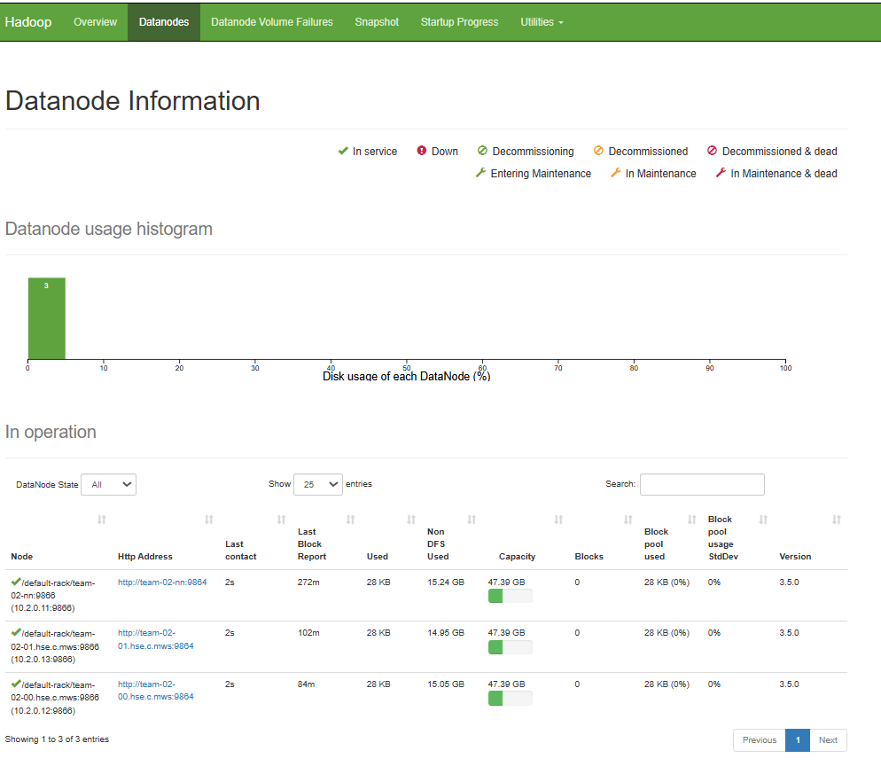
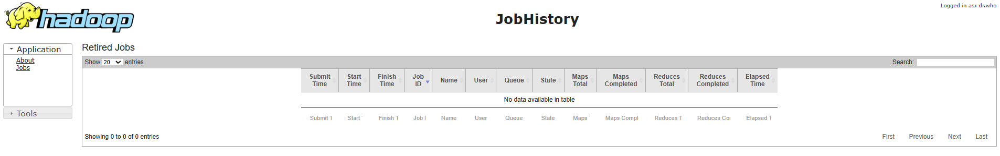
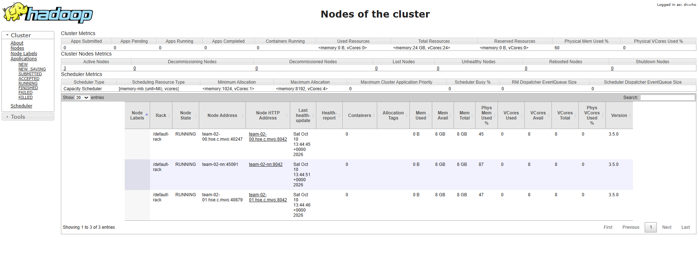

## Автоматизированное развертывание YARN
Репозиторий содержит скрипты и конфигурационные файлы для автоматизированного развертывания YARN поверх существующего кластера Hadoop HDFS. 

## Архитектура кластера

Развертывание производится на следующих виртуальных машинах (ОС Ubuntu):
* team-02-nn (10.2.0.11) - ResourceManager, NodeManager, JobHistoryServer.
* team-02-00 - NodeManager
* team-02-01 - NodeManager

## Структура репозитория

```
.
├── deploy-yarn.sh       # bash-скрипт автоматизированного развертывания
├── configs/             # конфигурационные файлы
│   ├── mapred-site.xml
│   ├── yarn-site.xml
└── evidences/           # скриншоты Web-интерфейса
```
## Инструкция по запуску
С локальной машины отправить скрипт и конфигурации на edge-ноду:
```
scp -i ~/.ssh/<SHH> -r deploy-yarn.sh configs team@<IP_EDGE_NODE>:~
ssh -i ~/.ssh/<SHH> team@111.88.128.191 
```
Затем выполнить:
```
chmod +x deploy-yarn.sh
./deploy-yarn.sh
```

## Веб интерфейс:




## Инструкция по остановке
Остановка HistoryServer: ssh -i ~/.ssh/team_internal team@team-02-nn "sudo -u andrey /home/andrey/hadoop/bin/mapred --daemon stop historyserver"

Остановка YARN: ssh -i ~/.ssh/team_internal team@team-02-nn "sudo -u andrey /home/andrey/hadoop/sbin/stop-yarn.sh"

Остановка HDFS: ssh -i ~/.ssh/team_internal team@team-02-nn "sudo -u andrey /home/andrey/hadoop/sbin/stop-dfs.sh"